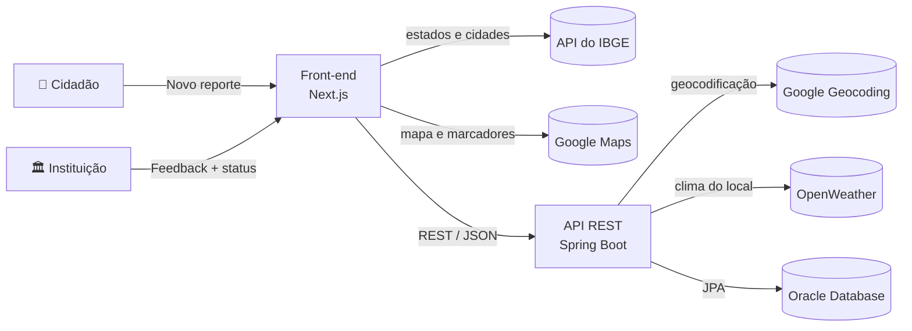
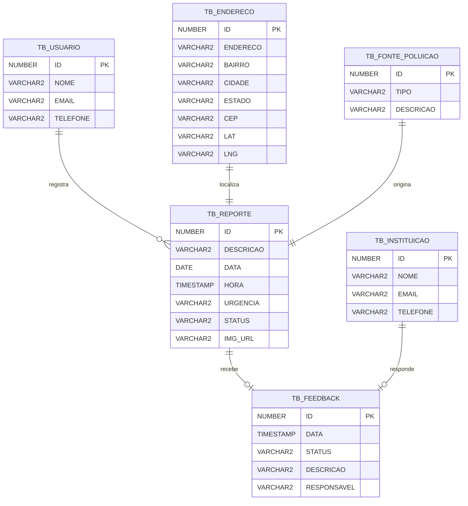

<div align="center">

# 🌊 Ocean: Blue Future

**Plataforma para denunciar e monitorar a poluição de oceanos e rios**, que conecta cidadãos a organizações ambientais.

Challenge **Blue Future**: *"Preservando os oceanos por meio da tecnologia"*, Global Solution FIAP 2024, turma 1TDSPS.


🔗 **[app-gs-blue-future.vercel.app](https://app-gs-blue-future.vercel.app)** · 🎬 **[Vídeo de demonstração](https://youtu.be/YYyqjHPeG4E)**

</div>

---

## Sumário

- [Sobre o projeto](#sobre-o-projeto)
- [Como funciona](#como-funciona)
- [Estrutura do repositório](#estrutura-do-repositório)
- [Front-end (Next.js)](#front-end-nextjs)
- [API REST (Spring Boot)](#api-rest-spring-boot)
- [Banco de dados (Oracle)](#banco-de-dados-oracle)
- [Análise de dados (Python)](#análise-de-dados-python)
- [Tecnologias](#tecnologias)
- [Como rodar localmente](#como-rodar-localmente)
- [Equipe](#equipe)

---

## Sobre o projeto

A poluição dos oceanos e rios, o descarte incorreto de lixo e a caça ilegal de animais marinhos muitas vezes são vistos por quem está no local, mas essas pessoas não sabem **a quem avisar**.

A **Ocean** resolve isso em três passos:

1. **O cidadão registra um reporte** com a fonte da poluição, uma descrição, o nível de urgência e o endereço.
2. **O endereço é geolocalizado** automaticamente e o reporte aparece em um **painel público com mapa**.
3. **ONGs e órgãos ambientais respondem** com um feedback e atualizam o **status** do caso, que vai de *Pendente* até *Resolvido*. Assim, todos acompanham o andamento com transparência.

Cada reporte ajuda a montar um mapa das áreas mais afetadas, o que permite uma resposta mais rápida e incentiva a responsabilidade ambiental.

---

## Como funciona



---

## Estrutura do repositório

O repositório reúne as entregas de cada disciplina da Global Solution:

| Pasta | Disciplina | Conteúdo |
| --- | --- | --- |
| [`ResponsiveWebDevelopment/`](ResponsiveWebDevelopment) | Responsive Web Development | Front-end em Next.js 14 + TypeScript |
| [`Driver Domain Design/`](Driver%20Domain%20Design) | Domain Driven Design | API REST em Java 21 + Spring Boot 3.3 |
| [`Building Relational Database/`](Building%20Relational%20Database) | Building Relational Database | Modelo de dados, scripts DDL/DML e documentação do banco Oracle |
| [`Computacional Thinking Using Py/`](Computacional%20Thinking%20Using%20Py) | Computational Thinking Using Python | Sistema em Python que analisa dados de poluição e grava no Oracle |
| `IA & ChatBot/` | IA & ChatBot | Apenas o README |
| `Software Design & Total Experience/` | Software Design & Total Experience | Apenas o README |

---

## Front-end (Next.js)

### Páginas

| Rota | Página | Descrição |
| --- | --- | --- |
| `/` e `/Inicial` | Início | Quem somos, como funciona, principais lixos encontrados nos oceanos e o impacto do projeto |
| `/Denuncia` | Novo Reporte | Formulário de denúncia |
| `/Reposta` | Confirmação | Mensagem de sucesso após o envio do reporte |
| `/DenunciaMap` | Reportes | Lista de reportes com filtro por estado, mapa geral e formulário de feedback |
| `/Contato` | Contato | E-mail, WhatsApp e redes sociais |

### Funcionalidades

- **Formulário de reporte** com dados do denunciante, tipo e descrição da fonte de poluição, descrição do problema, **urgência de 1 a 5** e endereço.
- **Estados e cidades** carregados da [API de localidades do IBGE](https://servicodados.ibge.gov.br/api/docs/localidades).
- **Painel de reportes**:
  - filtro por estado;
  - cada reporte mostra os dados, o status e o feedback da instituição, se houver;
  - botão **Mapa** que mostra o local exato no Google Maps;
  - **mapa geral** com todos os reportes marcados e o tipo de poluição em cada marcador.
- **Feedback das instituições**: a organização informa seus dados, o responsável, uma descrição da ação e o novo status do reporte:

  `Pendente` → `Em Análise` → `Ação Planejada` → `Em Progresso` → `Resolvido` / `Fechado` / `Inválido`

- **Layout responsivo** com menu de hambúrguer em telas menores e CSS Modules em cada página.
- **Textos da página inicial** separados em [`src/data/Text.json`](ResponsiveWebDevelopment/src/data/Text.json).

---

## API REST (Spring Boot)

API em camadas (`controllers`, `services`, `repositories`, `model`, `DTO`), com validação via Bean Validation e tratamento de erros centralizado.

### Endpoints

| Método | Endpoint | Descrição |
| --- | --- | --- |
| `POST` | `/reporte` | Cria um reporte junto com o usuário, a fonte de poluição e o endereço. O endereço é **geocodificado pelo Google**, o status começa como `Pendente` e a data e a hora são preenchidas automaticamente |
| `GET` | `/reporte/all` | Lista todos os reportes com usuário, endereço, fonte de poluição e feedback |
| `GET` | `/reporte/{id}` | Busca um reporte |
| `GET` | `/reporte/{id}/all` | Busca um reporte com todos os dados relacionados |
| `PATCH` | `/reporte/{id}` | Atualiza a descrição, a urgência ou a imagem |
| `DELETE` | `/reporte/{id}` | Remove o reporte e o feedback dele |
| `POST` | `/reporte/{id}/feedback` | Adiciona ou atualiza o feedback de uma instituição |
| `GET` | `/clima/reporte/{id}` | Clima atual no local do reporte, via OpenWeather: condição, temperatura em °C, umidade e pressão |
| `GET` | `/endereco` | Lista os endereços |
| `GET` | `/endereco/{id}` | Busca um endereço |
| `POST` | `/endereco` | Cadastra um endereço geocodificado |

<details>
<summary><strong>Exemplo: criar um reporte</strong></summary>

```http
POST http://localhost:8080/reporte
Content-Type: application/json
```

```json
{
  "usuario": { "nome": "Maria Silva", "email": "maria@email.com", "telefone": "11999999999" },
  "fontePoluicao": { "tipo": "Industrial", "descricao": "Descarte de efluentes no rio" },
  "endereco": { "endereco": "Av. Paulista, 1106", "cidade": "São Paulo", "estado": "SP" },
  "reporte": { "descricao": "Água escura e com forte odor", "urgencia": "4", "img_url": "https://exemplo.com/foto.jpg" }
}
```

A resposta traz o endereço completo (bairro, CEP, país, latitude e longitude) preenchido pela API do Google.

</details>

<details>
<summary><strong>Exemplo: enviar um feedback</strong></summary>

```json
POST /reporte/1/feedback

{
  "feedback": {
    "status": "Em Progresso",
    "descricao": "Equipe enviada para coleta de amostras",
    "responsavel": "João Souza",
    "img_url": "https://exemplo.com/acao.jpg"
  },
  "instituicao": { "nome": "ONG Mar Limpo", "email": "contato@marlimpo.org", "telefone": "1133334444" }
}
```

</details>

### Tratamento de erros

| Situação | Status HTTP |
| --- | --- |
| Recurso não encontrado | `404 Not Found` |
| Falha de validação (campo obrigatório vazio) | `422 Unprocessable Entity` |
| JSON inválido | `400 Bad Request` |

---

## Banco de dados (Oracle)

Modelagem feita no **Oracle SQL Developer Data Modeler** (`der.dmd` e pasta `der/`), com documentação em [`1TDSPS_2023_Proj_BD.docx`](Building%20Relational%20Database/1TDSPS_2023_Proj_BD.docx), que traz o dicionário de dados e os diagramas ER, lógico e relacional.



| Script | Conteúdo |
| --- | --- |
| [`1TDSPS_2023_CodigoSqlDDL.sql`](Building%20Relational%20Database/1TDSPS_2023_CodigoSqlDDL.sql) | Criação das 6 tabelas, com chaves primárias e estrangeiras |
| [`1TDSPS_2023_CodigoSqlDML.sql`](Building%20Relational%20Database/1TDSPS_2023_CodigoSqlDML.sql) | 30 registros de exemplo (5 por tabela) e consultas com `JOIN`, `GROUP BY`, `COUNT` e funções de data e texto |

---

## Análise de dados (Python)

Programa de terminal ([`programas/sistema.py`](Computacional%20Thinking%20Using%20Py/programas/sistema.py)) que carrega dois conjuntos de dados públicos em CSV para o Oracle e gera relatórios com **pandas**:

| Arquivo | Dados |
| --- | --- |
| `poluicao-agua-cidades.csv` | Índices de qualidade do ar e de poluição da água em cerca de 3.900 cidades do mundo |
| `desperdicio-plastico-per-capita.csv` | Lixo plástico mal gerenciado por pessoa (kg/ano) em cerca de 160 países e regiões, em 2019 |

**Menu do sistema:**

| Opção | Ação |
| --- | --- |
| 1 · 2 | Importar os CSVs para o banco |
| 3 · 4 | Exibir os dados importados |
| 5 | Média da qualidade do ar e da água por cidade e região |
| 6 | Cidades e regiões com a pior poluição do ar e da água |
| 7 | Total de lixo plástico acumulado por país ou região |
| 8 | Média de lixo plástico mal gerenciado por pessoa, por país e ano |
| 9 | Sair |

As tabelas usadas pelo programa estão em [`Tabela Banco de dados/PythonBd.sql`](Computacional%20Thinking%20Using%20Py/Tabela%20Banco%20de%20dados/PythonBd.sql).

---

## Tecnologias

| Camada | Tecnologias |
| --- | --- |
| **Front-end** | Next.js 14 (App Router), React 18, TypeScript, CSS Modules, `@react-google-maps/api`, Axios |
| **Back-end** | Java 21, Spring Boot 3.3 (Web, Data JPA, Validation), Hibernate, Lombok, Gson |
| **Banco de dados** | Oracle Database (`ojdbc10`), com H2 disponível para testes; Oracle SQL Developer Data Modeler |
| **Dados** | Python 3, `oracledb`, `pandas` |
| **APIs externas** | Google Maps JavaScript API, Google Geocoding API, OpenWeather, localidades do IBGE |
| **Deploy** | Vercel (front-end) |

---

## Como rodar localmente

### Pré-requisitos

- **Node.js** 18.17 ou superior
- **Java 21** (o Maven vem junto com o projeto, pelo wrapper `mvnw`)
- Acesso a um banco **Oracle** (ou use o H2 em memória para testar)
- Chaves do **Google Cloud**: Maps JavaScript API e Geocoding API
- Chave da **OpenWeather**
- **Python 3** com `oracledb` e `pandas`, se for rodar a parte de análise de dados

### 1. Banco de dados

No Oracle, execute na ordem:

```
Building Relational Database/1TDSPS_2023_CodigoSqlDDL.sql   # cria as tabelas
Building Relational Database/1TDSPS_2023_CodigoSqlDML.sql   # dados de exemplo (opcional)
```

### 2. API (Spring Boot)

Configure `Driver Domain Design/src/main/resources/application.properties`. O recomendado é ler os valores de variáveis de ambiente, para não deixar senhas e chaves no código:

```properties
spring.datasource.url=jdbc:oracle:thin:@<host>:1521:<sid>
spring.datasource.username=${DB_USER}
spring.datasource.password=${DB_PASSWORD}

google.api.key=${GOOGLE_API_KEY}
weatherMap.api.key=${OPENWEATHER_API_KEY}
```

> 💡 **Sem Oracle?** O arquivo já traz a configuração do **H2 em memória** comentada. Descomente as linhas do H2 e comente as do Oracle. As tabelas são criadas sozinhas e o console fica em `/h2-console`.

Depois, suba a API:

```bash
cd "Driver Domain Design"
./mvnw spring-boot:run        # no Windows: mvnw.cmd spring-boot:run
```

A API fica disponível em **http://localhost:8080**.

### 3. Front-end (Next.js)

```bash
cd ResponsiveWebDevelopment
npm install
npm run dev
```

Acesse **http://localhost:3000**.

> ℹ️ O front-end chama a API em `http://localhost:8080`. A chave do Google Maps fica em `src/components/MapPage/MapPage.tsx` e `src/components/MapPageReporte/MapPageReporte.tsx`.
>
> Na versão publicada na Vercel, as páginas de **Novo Reporte** e **Reportes** só funcionam com a API rodando localmente.

| Script | Descrição |
| --- | --- |
| `npm run dev` | Servidor de desenvolvimento |
| `npm run build` | Build de produção |
| `npm start` | Sobe o build de produção |
| `npm run lint` | ESLint |

### 4. Análise de dados (Python), opcional

```bash
pip install oracledb pandas
```

1. Crie as tabelas com `Computacional Thinking Using Py/Tabela Banco de dados/PythonBd.sql`.
2. Preencha usuário, senha e DSN do Oracle na função `conecta_BD()` de `sistema.py`.
3. Rode o programa **de dentro da pasta `programas`**, porque os CSVs são lidos por caminho relativo:

```bash
cd "Computacional Thinking Using Py/programas"
python sistema.py
```

---

## Equipe

| Integrante | GitHub |
| --- | --- |
| Gustavo Araújo Maia | [@Gusmaiadev](https://github.com/Gusmaiadev) |
| Kauã Almeida Silveira | [@KauaAlmeidaSilveira](https://github.com/KauaAlmeidaSilveira) |
| Rafael Vida Fernandes | — |

Turma **1TDSPS**, FIAP.

<div align="center">

🐢 *Seu reporte pode ser o primeiro passo para um oceano mais limpo e saudável para as futuras gerações.*

</div>
